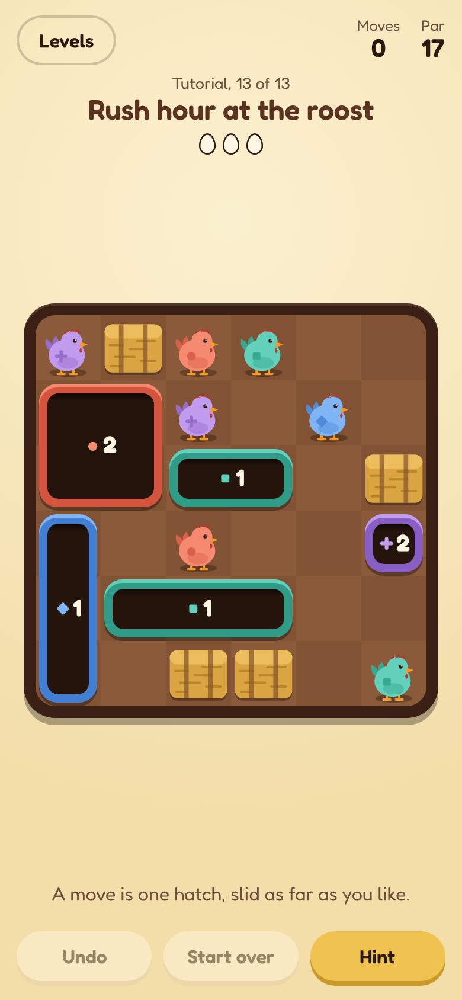

<div align="center">

# 🐔 Down the Hatch

**A sliding puzzle for your phone.**<br>
Slide the hatches, drop the chickens, clear the coop.

### [▶️ Play it here](https://pinardy.github.io/down-the-hatch/)

📲 Installable · ✈️ Works offline · 🧩 361 levels



</div>

## 🎮 How to play

- 👆 **Drag a hatch to slide it.** It drops in any chickens **of its own colour** that it passes over.
- 🚧 **Mind what's in the way.** Hay bales, other hatches and other-coloured chickens block it.
- 🔢 **Watch the number.** It's how many more chickens a hatch can take. Full hatches leave the board.
- 🥚 **Clear every chicken.** Match par (the fewest moves) for three eggs. Two eggs allow a little over par: two moves on a short level, a quarter of par on a long one.
- 🤔 **Not sure why a hatch won't move?** Push it into whatever stops it and the game shows what's in the way, and why.

## 🗺️ Chapters and pieces

361 levels in 42 chapters, each tagged Easy, Medium, Hard or Expert. After the tutorial, each chapter adds one new piece and works up to it gently:

| | Piece | What it does |
|:-:|---|---|
| 📐 | **Bent hatches** | L and T shapes that need room for every corner |
| 🧊 | **Frozen hatches** | stuck until enough chickens have dropped |
| 🔒 | **Padlocked hatches** | stuck until another hatch slides over the key |
| 🥚 | **Eggs** | chickens whose colour is hidden until a hatch slides up beside them |
| 🪵 | **Cracked boards** | hold for one crossing, then leave a hole nothing can cross |
| 🤍 | **White chickens** | drop down any hatch, and take up room in it |
| ⛓️ | **Chained hatches** | two that slide together, or not at all |
| 🎨 | **Paint** | a hatch that slides through a puddle takes its colour |
| 🚪 | **Gates and plates** | a gate opens only while a hatch stands on a pressure plate |
| ➡️ | **One-way squares** | can only be crossed the way the arrow points |
| ⛸️ | **Slippery floor** | a hatch on it can't stop until something stops it |
| 📦 | **Crates** | a hatch shoves them a square at a time, onto bare floor |
| 🔄 | **Turntables** | swing a hatch a quarter turn, if there's room |
| 🐇 | **Burrows** | a one-square hatch goes in one end and out of the other |
| 💨 | **Skittish chickens** | hop away from a hatch that stops beside them; corner them |
| 🪞 | **Mirrored hatches** | slide opposite ways: one goes left, the other goes right |
| 🚪 | **Levers and doors** | slide onto a lever and every door flips, shut to open and open to shut |
| 🥾 | **Tired hatches** | can only be picked up so many times |
| 🔢 | **Pecking order** | numbered chickens must be taken in turn |
| 🚧 | **Fences** | thin walls along square edges that nothing crosses |
| 🐔 | **Stacked chickens** | take the top one, then come back for the one underneath |

Four more chapters (*Thin ice*, *Mystery guests*, *Chain of custody*, *Tangled*) pair a newer piece with an older one. The hard chapters combine them, at up to 34 moves a level.

The newest pieces, paint, gates and one-way squares, each get a Hard chapter of their own (*Wet paint*, *Gatekeeper*, *One way only*), and the Expert chapter *The workshop* puts all three in one yard, up to 43 moves a level.

Five more chapters pair the newest pieces with older ones: *Hold the line* (gates and chains), *Burnt bridges* (one-way squares and cracked boards) and *Colour me surprised* (paint and eggs) are Hard; *Big freeze* (frozen hatches, bends and gates) and *Safe cracking* (padlocks, paint and eggs) are Expert, up to 37 moves a level.

Five Medium chapters bring in the newest pieces, one each: *Skid row* (slippery floor), *Shove off* (crates), *Spin doctor* (turntables), *Down the rabbit hole* (burrows) and *Flight risk* (skittish chickens). Three Hard chapters take them further: *Turning point* (turntables among bent hatches, up to 21 moves), *Goods in* (crates and padlocks) and *Pick and mix* (the newest pieces in twos, and twice all five at once).

Six more Medium chapters bring in the newest pieces, one each: *Opposite numbers* (mirrored hatches), *Doorkeepers* (levers and doors), *Running ragged* (tired hatches), *Mind your manners* (the pecking order), *Over the fence* (fences) and *Two up* (stacked chickens).

## 🛟 Help when you need it

- ↩️ **Undo** and 🔄 **Start over** are always there.
- 💡 **Hint** first names the hatch to move and makes it glow; press **Show where** to see it walk its path.
- ⏪ **Rewind** appears when you've slid into a dead end, and takes you back to the last position that can still be won.
- 💾 **Leave mid-level** and it's waiting where you left it.

## ✨ More to play for

- 📅 **Daily coop:** one extra board a day, the same for everyone, easiest on Monday and hardest on Sunday. Keep a 🔥 streak by playing on consecutive days. It opens once the tutorial is done, the last six days can be caught up on (they don't count towards the streak), and you can share your result without giving the board away.
- 🏁 **Weekly gauntlet:** five boards in a row on one budget of moves, the same for everyone that week. Undo and Start over are free on a board, but overspend and the run is over. Your best each week can be shared.
- 🧭 **Four tabs:** Levels, Daily, Endless and You, along the bottom of the main screen.
- ♾️ **Endless coop:** fresh puzzles grown on your phone on the spot, Easy, Medium or Hard, as many as you like. Each is checked so it can be cleared, preferring ones that can go wrong, and can be shared as a link. Leave one part-way and resume it later.
- 💡 **First meetings:** the first time a piece turns up (in the daily, say, before its chapter), a line under the board says what it does.
- 🎵 **Music:** gentle tunes that change with where you are (the daily coop, the hard chapters and so on) and are made up afresh as they go, with separate volumes for music and sound effects.
- ⭐ **Stars:** clear a level without a hint and its tile gets a star.
- 🎬 **Best solution:** finish over par and watch the fewest-moves solution play out.
- ⏱️ **Race the clock:** an optional countdown; beat it for a clock badge on the level.
- 🔥 **Hard mode:** no undo, no hints, no rewind. Clear a level that way and it earns a flame.
- 🏆 **Stats and achievements:** levels, eggs, streaks and endless clears at a glance, and fifteen goals to work towards.
- 🔍 **Filters:** show only the levels not yet cleared, short of three eggs, or without a star.
- 🎩 **Rewards:** eggs, stars and daily coops unlock board themes and hats for the chickens. Settings and rewards are a tap away on every screen.
- 🛠️ **Level editor:** build your own coop. The game checks it can be cleared, sets its par, and gives you a link to send to anyone.
- ♿ **Accessibility:** larger text, high contrast, reduced motion, vibration on or off, and a spoken description of every board for screen readers.
- 🔐 **Backups:** progress is saved in your browser. A backup code (under *Your progress* on the You tab) carries it, endless clears included, to another phone or browser.

## 🧑‍💻 Development

```bash
npm install
npm run dev      # local dev server
npm test         # rules tests; every level is solved and its par checked
npm run solutions # after changing levels: store each one's best solution, for hints
npm run build    # bundle to dist/
```

- ⚙️ The game engine lives in `src/game/`: plain TypeScript, with a solver for par and hints.
- 🎨 The React UI lives in `src/ui/` (the play screen's parts in `src/ui/play/`), and the styles in `src/styles/`, one file per area.
- 🎵 Sound is synthesised: `src/music.ts` works out what the music plays, `src/sfx.ts` makes the sound.
- 🧱 See [docs/levels.md](docs/levels.md) to add or generate levels.
- 🚀 Pushes to `main` are tested, built and deployed to GitHub Pages by [`.github/workflows/deploy.yml`](.github/workflows/deploy.yml).
