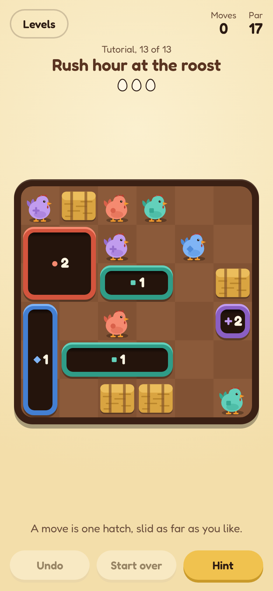

<div align="center">

# 🐔 Down the Hatch

**A sliding puzzle for your phone.**<br>
Slide the hatches, drop the chickens, clear the coop.

### [▶️ Play it here](https://pinardy.github.io/down-the-hatch/)

📲 Installable · ✈️ Works offline · 🧩 158 levels



</div>

## 🎮 How to play

- 👆 **Drag a hatch to slide it.** It drops in any chickens **of its own colour** that it passes over.
- 🚧 **Mind what's in the way.** Hay bales, other hatches and other-coloured chickens block it.
- 🔢 **Watch the number.** It's how many more chickens a hatch can take. Full hatches leave the board.
- 🥚 **Clear every chicken.** Match par (the fewest moves) for three eggs. Two eggs allow a little over par: two moves on a short level, a quarter of par on a long one.
- 🤔 **Not sure why a hatch won't move?** Push it into whatever stops it and the game shows what's in the way, and why.

## 🗺️ Chapters and pieces

158 levels in 19 chapters, each tagged Easy, Medium, Hard or Expert. After the tutorial, each chapter adds one new piece and works up to it gently:

| | Piece | What it does |
|:-:|---|---|
| 📐 | **Bent hatches** | L and T shapes that need room for every corner |
| 🧊 | **Frozen hatches** | stuck until enough chickens have dropped |
| 🔒 | **Padlocked hatches** | stuck until another hatch slides over the key |
| 🥚 | **Eggs** | chickens whose colour is hidden until a hatch slides up beside them |
| 🪵 | **Cracked boards** | hold for one crossing, then leave a hole nothing can cross |
| 🤍 | **White chickens** | drop down any hatch, and take up room in it |
| ⛓️ | **Chained hatches** | two that slide together, or not at all |
| 🎨 | **Paint** | a hatch that slides through a puddle takes its colour |
| 🚪 | **Gates and plates** | a gate opens only while a hatch stands on a pressure plate |
| ➡️ | **One-way squares** | can only be crossed the way the arrow points |

Four more chapters (*Thin ice*, *Mystery guests*, *Chain of custody*, *Tangled*) pair a newer piece with an older one. The hard chapters combine them all and take 14 to 34 moves a level.

## 🛟 Help when you need it

- ↩️ **Undo** and 🔄 **Start over** are always there.
- 💡 **Hint** walks a hatch along its path to show the next slide.
- ⏪ **Rewind** appears when you've slid into a dead end, and takes you back to the last position that can still be won.
- 💾 **Leave mid-level** and it's waiting where you left it.

## ✨ More to play for

- 📅 **Daily coop:** one extra board a day, the same for everyone, easiest on Monday and hardest on Sunday. Keep a 🔥 streak by playing on consecutive days. It opens once the tutorial is done, the last six days can be caught up on (they don't count towards the streak), and you can share your result without giving the board away.
- ⭐ **Stars:** clear a level without a hint and its tile gets a star.
- 🎬 **Best solution:** finish over par and watch the fewest-moves solution play out.
- ⏱️ **Race the clock:** an optional countdown; beat it for a clock badge on the level.
- 🎩 **Rewards:** eggs, stars and daily coops unlock board themes and hats for the chickens. Settings and rewards are a tap away on every screen.
- 🛠️ **Level editor:** build your own coop. The game checks it can be cleared, sets its par, and gives you a link to send to anyone.
- 🔐 **Backups:** progress is saved in your browser. A backup code (under *Your progress* on the level list) carries it to another phone or browser.

## 🧑‍💻 Development

```bash
npm install
npm run dev      # local dev server
npm test         # rules tests; every level is solved and its par checked
npm run build    # bundle to dist/
```

- ⚙️ The game engine lives in `src/game/`: plain TypeScript, with a solver for par and hints.
- 🎨 The React UI lives in `src/ui/`.
- 🧱 See [docs/levels.md](docs/levels.md) to add or generate levels.
- 🚀 Pushes to `main` are tested, built and deployed to GitHub Pages by [`.github/workflows/deploy.yml`](.github/workflows/deploy.yml).
